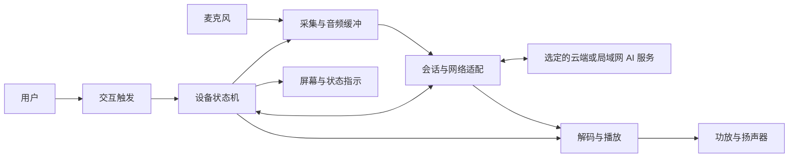

# GPT 方块项目：详细思路大纲

日期：2026-10-19。状态：**总体设计草案，供用户与 Codex 讨论；角色分工已确认。**

## 一、目标与当前事实

目标：做一个带屏幕、麦克风和扬声器的桌面语音 AI 方块。用户能够发起对话、听到回答，并从屏幕看懂设备状态。移动供电作为后续阶段，不能抢在可用性与安全验证之前。

已确认：Codex 负责设计与监督；DS 写项目代码；HY 经 WorkBuddy 做任务可视化、记录进度并维护本地 Git；Kimi 经 WorkBuddy 调研成熟案例。共享区为当前文件夹。

主板已确定：用户于 2026-10-19 明确已下单微雪 **ESP32-S3-LCD-1.47B-M**，后续设计以此型号为准。已下单不等于已到货或实机通过。

尚未确认：到货与实物版本、其他器件购买情况、预算上限、开发经验与可投入时间、最终模型服务、唤醒和打断是否为首版必需、外壳尺寸、续航目标。

板级资料以微雪 B/B-M 官方页面为入口：https://docs.waveshare.net/ESP32-S3-LCD-1.47B/ 。2026-10-19 文档核对：LCD_BL 为 GPIO46；禁止沿用非 B 页面中的 GPIO48。完整接线仍须结合原理图、实物版本和音频方案审查。Kimi 首轮调研需返工，见 `审查/RES-001-Codex审查-2026-10-19.md`；软件基线尚未批准。

参考输入：`/Users/gasolutelei/program/VIBEcode/deepseek harness/GPT方块-采购与实施计划.md`。保留原文件；其中“已决策”指原文的表述，不代表当前监督审查已经通过。

## 二、首版体验边界（拟定）

| 重要性 | 体验 | 首版拟定范围 | 验收方式 |
|---|---|---|---|
| 5/5 | 一次对话闭环 | 用户触发、收音、提交、等待、播放、返回待机 | 实机完成完整流程并留日志 |
| 5/5 | 状态可理解 | 开机、未联网、待机、聆听、思考、说话、错误 | 屏幕与实际事件一致 |
| 5/5 | 可恢复 | 网络失败、服务失败后有提示且可重试 | 注入失败并观察恢复 |
| 4/5 | 触发方式 | 首先比较按键触发和本地唤醒的成本，再决定首版 | 用户确认体验优先级 |
| 3/5 | 播放中打断 | 独立验收项，不把 AEC 当成默认已具备能力 | 在指定环境验证漏唤醒、误触发和回声 |
| 3/5 | 移动使用 | 电池路线恢复且通过专项审查后实施 | 实测续航与温升 |

首版先解决“能稳定听、说、聊、反馈状态”。多角色人格、复杂动画、长期记忆、云端管理等扩展需求单独提出，经过设计评估后再排期。

## 三、逻辑架构

这是功能拆分，不是重新从零实现所有模块的要求。Kimi 先查成熟工程，Codex 决定复用边界，DS 尽量保留上游已验证链路。

### 设备端设计问题

- 板级适配：明确板号、芯片、存储、屏幕、可用 GPIO、保留引脚和版本差异。
- 音频链路：采样格式、时钟、缓冲、麦克风与功放的供电和接口；共享或独立 I2S 根据驱动及芯片资料决定。
- 会话状态：触发、录音结束、等待、播放、取消、超时和重连时各模块如何协作。
- 配置：首次联网、服务地址、凭证注入、配置恢复；不将私人配置写死在固件中。
- 诊断：提供可理解的错误码、有限日志和版本信息，默认避免保存语音内容。

### 服务端设计问题

- 比较成熟服务直接接入、已有自建服务和必要的适配层，明确费用、认证、隐私与维护成本。
- 明确语音识别、模型推理、语音合成由谁提供；设备端承担哪些处理。
- 区分“无需电脑连接”“断网能用”和“局域网推理”，不能混称离线。
- 弱网、密钥失效、配额不足、连接中断都有明确用户反馈。

## 四、Kimi 调研框架

任务：找成熟 ESP32 AI 硬件实例，提供可复用依据，而不是罗列商品或展示视频。

| 重要性 | 筛选维度 | 必须提交的证据 |
|---|---|---|
| 5/5 | 代码真实可用 | 官方仓库、固定版本/提交、构建说明、最近维护状态 |
| 5/5 | 硬件可适配 | 芯片、屏幕、麦克风、音频输出、GPIO/原理图来源 |
| 5/5 | 许可可接受 | LICENSE 原文链接，复用和分发限制；缺许可证不能默认可复制 |
| 4/5 | 服务端可获取 | 服务协议、认证方式、收费/部署要求、依赖条件 |
| 4/5 | 复现成本可控 | 可直接复用、需修改、不可直接复用的模块清单 |
| 4/5 | 成熟度有依据 | 发布记录、实际构建证据、已知问题；不能只按星数评分 |
| 3/5 | 结构可借鉴 | 外壳源文件、尺寸、麦克风声孔、扬声器与天线布局 |

产物：`research/案例对比.md`、`research/推荐路线.md`。每个候选先给五分制推荐指数和理由，注明检索日期，区分项目声明、已读代码、已运行验证。候选数量以能支持路线取舍为准。

`xiaozhi-esp32` 是原计划提到的待调查线索，不是本次已核定版本或自动采用决定。Kimi 必须核查真实上游与当前限制。

## 五、阶段计划与放行条件

| 阶段 | 负责人 | 工作与产物 | 放行条件 |
|---|---|---|---|
| A 需求收敛 | Codex + 用户 | 首版范围、体验流程、预算边界、硬件现状 | 关键需求明确，未决项有记录 |
| B 案例调研 | Kimi | 案例对比、复用清单、许可证、技术风险 | Codex 可追溯来源并完成路线比较 |
| C 总体设计 | Codex | 选定基线、架构、引脚/供电审查、接口约定、验收目标 | 用户确认重要取舍；实现任务条件齐备 |
| D 最小构建 | DS | 固定版本、构建说明、配置模板、可复现日志 | Codex 核对可构建；实机未测单独标明 |
| E USB 硬件验证 | DS + 用户 | 屏幕、输入、录音、播放的分项测试和证据 | 分项通过；不能跳过供电和引脚核对 |
| F 对话集成 | DS | 单轮对话、状态 UI、失败恢复 | 依据测试清单通过，日志与体验一致 |
| G 体验优化 | DS，Codex 验收 | 唤醒、打断、音频效果、稳定性优化 | 分别提交实测，不以主观“很好用”代替 |
| H 电池与结构 | 暂停；恢复后由 Codex 设计审查、DS 适配、用户实测 | 电源方案、实物尺寸、结构图、测试记录 | 安全证据及实测齐备后才能装入外壳 |
| I 交付 | 全员，Codex 汇报 | 固件版本、装配说明、已知问题、恢复流程 | 用户可按文档复现和维护 |

HY 持续记录真实任务、阻塞和验收状态；Codex 判断达到一个小阶段时，提出一次可视化汇报任务，由 HY 制作、Codex 审查后向用户展示一次。Git 本地提交与 GitHub 推送仅在用户明确说“同步”后执行，详见 `AGENTS.md`。日历工期在硬件现状、路线和用户投入时间明确后估计；旧计划的“一个周末”不作为承诺。

## 六、验收体系

### 验收层次

1. 静态审查：实现范围、许可证、引脚冲突、配置与凭证、故障路径。
2. 构建验证：工具链和依赖版本、构建命令、实际输出与失败信息。
3. 模块验证：屏幕、收音、播放、网络分别验证，避免混在一起无法定位问题。
4. 集成验证：完整对话、取消、断网、服务错误、重连。
5. 实物验证：电压、电流、温升、接线与结构；缺少仪器或硬件时明确阻塞。
6. 用户体验验收：设备状态是否能看懂，触发是否自然，声音是否满足桌面场景。

### 需要制定的指标（当前没有实测值）

| 指标 | 测量方式 | 当前状态 |
|---|---|---|
| 开机到可交互时间 | 日志时间戳 + 实物观察 | 目标待协商，未测 |
| 对话首段响应延迟 | 录音结束到首次播放的时间差 | 目标待协商，未测 |
| 连续对话成功率 | 固定测试脚本，记录成功/总次数和错误分类 | 场景待定，未测 |
| 唤醒与误触发 | 明确距离、环境声、样本数 | 首版必要性待定 |
| 运行稳定性 | 明确时长和负载，记录重启/内存/错误 | 目标待定，未测 |
| 供电与温升 | 指定测点、仪器、环境、充放电状态 | 电池相关暂停 |

不把编译通过当成录音或电源验证；不把平均值掩盖偶发失败；故障必须保留复现条件。

## 七、HY 可视化要求

制作时机：由 Codex 根据小阶段成果提出任务，注明本次范围与证据；HY 不自行按改动频率生成阶段汇报。

交付位置：`dashboard/index.html`，优先本地打开即可查看的简洁页面；必要资源放同目录。

- 首页展示：当前阶段、下一步、阻塞原因、等待谁处理、最新交付与审查结论。
- 任务卡展示：任务编号、负责人、状态、依赖、产物链接、证据链接、最后更新时间。
- 里程碑分开显示“计划目标”和“实际验收”，未知值显示“未测/待确认”。
- 显示来源台账及更新时间；页面不是已自动同步的承诺。离线页面更新后由 HY 重新生成或采用明确的数据读取方式。
- 不用无依据的完成百分比；若显示完成数，必须由任务状态计算并说明口径。
- 用户能点开原始产物和证据；避免把实现细节挤进首页。
- Codex 检查显示是否与台账一致、链接是否可用、未决项是否遗漏，再向用户汇报。

## 八、旧计划的复核清单

以下是需要复核的主张，不是已经证伪的结论：

| 重要性 | 旧计划主张 | 本轮处理 |
|---|---|---|
| 5/5 | 功放统一从板载 3.3V 供电，增大电容即可解决掉压 | 先核算供电余量、瞬态负载、散热与实际供电路径 |
| 5/5 | 2A 自恢复保险丝足以保护线路 | 按型号的保持/动作电流、动作时间、温度特性与线材核对 |
| 5/5 | 电池电压处于单一窄区间即可判断合格 | 根据具体电芯、荷电状态和规格制定到货检查方法 |
| 4/5 | 两路 I2S 是唯一方案；其他芯片不能实现 | 由具体接口、驱动及成熟项目证据判断，不按概括性判断排除 |
| 4/5 | MicroPython 一定是最快硬件验证路线 | 与直接用目标固件/官方例程比较，避免双栈迁移成本 |
| 4/5 | AEC、唤醒词只在某个框架可用 | 检查目标工程、库、许可和硬件条件，避免绝对表述 |
| 3/5 | 固定预算、短工期、消除一定比例风险 | 重新估算并标来源；没有证据的比例不沿用 |

## 九、下一轮与用户沟通的问题

按实际影响依次讨论，不要求一次回答全部：

1. 首版最重要的使用场景是什么：桌面问答、学习助手，还是其他具体动作？
2. 按键发起是否能接受，还是第一版必须语音唤醒和打断？
3. 哪些硬件已买/已到手，哪些仍只是收藏？
4. 接受的总预算、持续服务费用和实际可投入时间是多少？
5. 先追求成熟项目复现还是外观/交互创新？哪些必须保持自己的设计？

这些答案由 Codex 写入决策记录，再决定实现范围。调研可以先行，可视化按 Codex 的阶段汇报任务制作，生产固件实现等待基线设计确定。
